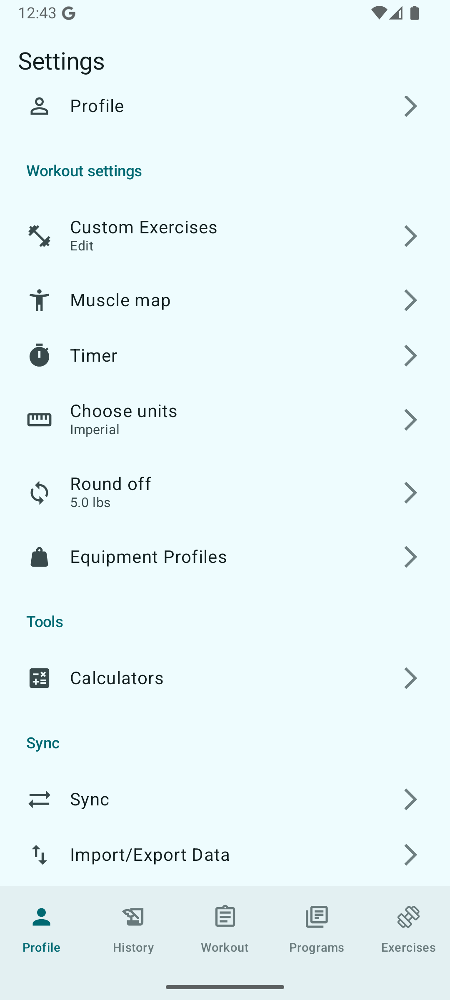
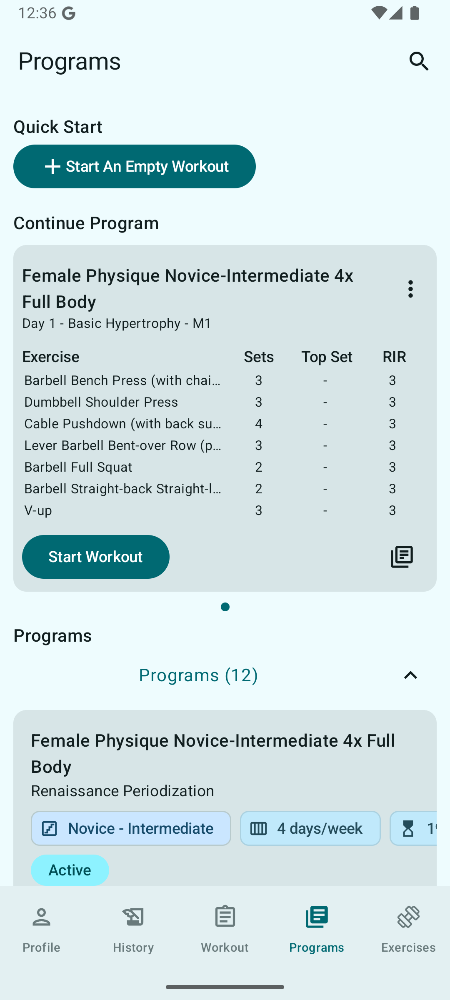

# YKD - Private-Focused Workout Logger


> A privacy-focused, open source workout logging app that helps you track your training, monitor progress, and own your fitness data.

[//]: # (A modern, Local-First Android application for tracking bodybuilding and strength training progress, built with **Jetpack Compose** and **Couchbase Mobile**.)

## Table of Contents

- [Key Features](#key-features)
- [Screenshots](#-screenshots)
- [About the Project](#-about-the-project)
- [Tech Stack](#-tech-stack)
- [Getting Started](#-getting-started)
    - [Prerequisites](#prerequisites)
    - [Installation](#installation)
- [Features](#features)
    - [Advanced Set Programming](#advanced-set-programming)
    - [Complete Workout Logging & Tracking](#complete-workout-logging--tracking)
    - [Exercise Database & Customization](#exercise-database--customization)
    - [Structured Programming](#structured-programming)
    - [Analytics & Insights](#analytics--insights)
    - [Workout Customization Tools](#workout-customization-tools)
    - [Data Management](#data-management)
- [Future Improvements](#-future-improvements)
- [Contributing](#-contributing)
- [License](#-license)

## Key Features

[//]: # (*   **Workout Tracking:** Real-time session tracking, set/rep logging, intensity &#40;RIR/RPE&#41;, and rest timers.)

[//]: # (*   **Progress Workouts Programmatically:** Linear, Double Progression, Dynamic Double Progression, Wave, and AMRAP)

[//]: # (*   **Advanced Set Programming:** Intelligent warm-up and working set generators that help you structure your training with precision)

[//]: # (*   **Workout Programs:** Create, manage, and share workout programs using the Desktop App.)

[//]: # (*   **Analytics:** Progress charts, Muscle Engagement Heatmaps, 1RM estimates.)

[//]: # (*   **Sync & Backup:** Local-first architecture using Couchbase Lite and Sync Gateway.)

- 💪 **Smart Set Programming** - RIR/RPE-based loading with automatic warm-up and working set calculations
- 📊 **Comprehensive Analytics** - Track PRs, visualize progress, and monitor muscle engagement with interactive charts
- 📝 **Structured Programs** - Follow periodized training programs with mesocycle tracking and progression
- 🎯 **Detailed Exercise Database** - Complete muscle mapping, equipment specs, and YouTube integration
- 📱 **Complete Workout History** - Never lose a workout with full logging, searchable history, and performance trends
- 🔒 **Privacy-First, Local-First** - Your data stays local with optional sync on your terms
- 🔧 **Highly Customizable** - Custom exercises, equipment profiles, unit preferences, and flexible programming
- 📈 **Progress Tracking** - Automatic 1RM estimation, volume tracking, and personal records across all rep ranges

## 📱 Screenshots

<div style="display: flex; gap: 10px;">
  
  
  
</div>


## 💡 About the Project

YKD is a powerful, privacy-focused workout logging application designed to help you track your fitness journey with precision and simplicity. Built for athletes, fitness enthusiasts, and anyone committed to their training goals, YKD provides the tools you need to log workouts, monitor progress, and stay consistent—without the bloat of social features or subscription fees.

### Why YKD?

**Own Your Data** - Your workout history belongs to you. YKD keeps your data local and private, with optional cloud sync on your terms.

**Track What Matters** - Log exercises, sets, reps, weight, time, and notes with an intuitive interface that gets out of your way so you can focus on your workout.

**See Your Progress** - Visualize your strength gains, volume trends, and personal records over time with built-in analytics and charts.

**Open Source** - Community-driven development means YKD evolves based on real user needs. Contribute features, report bugs, or fork the project to make it your own.

[//]: # (Whether you're a powerlifter tracking every kilogram or someone just starting their fitness journey, YKD adapts to your training style without forcing you into a one-size-fits-all approach.)

---

*Get yoked. Stay consistent. Own your progress.*

## 🛠 Tech Stack

* **Language:** Kotlin
* **UI Framework:** Jetpack Compose (Material Design 3)
* **Database:** Couchbase Lite (Local), Couchbase Server + Sync Gateway (Remote)
* **Synchronization:** Couchbase Server, Couchbase Sync Gateway, & Docker
* **Observability:** Firebase Crashlytics & Analytics, New Relic
* **Testing:** JUnit 5 & Jqwik (Property-based testing)
* **Build Tool:** Gradle (Kotlin DSL)
* **Data Visualization:** Rive & Plotly.js

[//]: # (## 🏗 Architecture & Engineering Highlights)

[//]: # ()
[//]: # (### 1. Local-First Synchronization)

[//]: # (The core of the app relies on **Couchbase Lite**. The implementation handles:)

[//]: # (* **Local Persistence:** All CRUD operations happen against the local database first, ensuring zero latency for the user.)

[//]: # (* **Sync Gateway Configuration:** I configured a custom Sync Gateway on a Docker container to handle replication.)

[//]: # (    * *Challenge:* Configuring the routing and channels for correct user data segregation was complex. It required roughly two weeks of iterative testing to correctly map the configuration JSON to the application's document structure.)

[//]: # (    * *Result:* Seamless bi-directional sync between the Android client and the backend.)

[//]: # (### 2. Modern UI State Management)

[//]: # (The UI is built 100% in Jetpack Compose, avoiding XML layouts entirely.)

[//]: # (* utilized `StateFlow` and `ViewModel` to expose UI state.)

[//]: # (* Handled complex side-effects &#40;like navigation and database callbacks&#41; while keeping the UI code declarative and pure.)

[//]: # (### 3. Property-Based Testing)

[//]: # (Instead of relying solely on example-based unit tests, I integrated **Jqwik** for property-based testing.)

[//]: # (* *Why?* To ensure the workout logic &#40;e.g., volume calculations, plate math&#41; holds true for *any* valid input, not just the "happy path" numbers.)

[//]: # (* This approach helped identify edge cases in input validation that standard unit tests missed.)

## 🚀 Getting Started

### Prerequisites
* Android Studio Ladybug (or newer)
* JDK 17+
* Docker (if running Couchbase Server & Couchbase Sync Gateway locally)

### Installation
1.  **Clone the repository**
    ```bash
    git clone https://github.com/pr0m3theuz/workout-app.git
    cd workout-app
    ```
2.  **Open in Android Studio** and let Gradle sync.
3.  **Run the Couchbase Server & Sync Gateway (Optional for Remote Sync, Multi-device Support, & Data Backup)**
    ```bash
    git clone https://github.com/pr0m3theuz/workout-app-server.git
    cd backend
    docker-compose up -d
    ```
4.  **Build and Run** on an Emulator or Physical Device.

## Features

### Advanced Set Programming

YKD includes intelligent warm-up and working set generators that help you structure your training with precision:

- **Percentage-Based Loading** - Automatically calculate warm-up and working set weights based on your 1RM or target working weight
- **RIR/RPE Integration** - Program sets using Reps in Reserve (RIR), Rate of Perceived Exertion (RPE), or percentage of estimated 1RM (e1RM)
- **Modernized Load Editor** - Flexible set configuration that adapts to your preferred training methodology
- **Warm-up Set Generator** - Create progressive warm-up schemes that automatically scale to your working weight
- **Working Set Templates** - Quickly program working sets with target percentages, reps, and RIR values
- **Back-off Set Support** - Insert calculated back-off sets after your top sets for volume management
- **Batch Set Management** - Apply settings to multiple sets at once, then edit individual sets as needed

The app calculates actual weights, reps, and intensity targets on the fly, showing you exactly what to lift (e.g., "88.18 x 9 @ 1.0 RIR") so you can focus on execution rather than mental math during your workout.

### Complete Workout Logging & Tracking

- **Detailed Exercise Logging** - Track weight, reps, and RIR for every set with an intuitive interface that shows previous set performance for reference
- **Workout History** - Browse all past workouts by month with summary stats including duration, total volume, and number of sets
- **Exercise History** - View complete performance history for any exercise across all workouts, organized chronologically
- **Personal Records Tracking** - Automatic calculation and display of estimated 1RM, max volume, max weight lifted, and best performance by rep range
- **Progress Visualization** - Charts showing strength progression over time for estimated 1RM and maximum weight lifted
- **Workout Summaries** - Clean, expandable summaries of completed workouts showing all exercises, sets, volume, and duration
- **Quick Repeat** - "Perform Again" button to instantly recreate a previous workout

### Exercise Database & Customization

- **Comprehensive Exercise Library** - Built-in database with detailed exercise information including equipment, primary muscles, muscle groups, mechanics, and utility classification
- **Custom Exercise Creation** - Add your own exercises to supplement the built-in database
- **Muscle Map** - Visual breakdown showing target muscles, synergists, and stabilizers for each exercise
- **Exercise Search** - Quick search functionality across all exercises
- **YouTube Integration** - Direct links to search for exercise demonstrations on YouTube
- **Equipment Profiles** - Configure different equipment setups for various training locations

### Structured Programming

- **Workout Programs** - Import and follow structured training programs with multiple mesocycles and phases
- **Program Tracking** - Clear visualization of program structure, current week, and remaining workouts
- **Mesocycle Management** - Programs organized into phases with specific training protocols
- **Program Library** - Browse available programs with details on difficulty level, equipment needs, frequency, and duration
- **Continue Workout** - Quick access to your current program day with one-tap start

### Analytics & Insights

- **Weekly Reports** - Comprehensive stats including workouts completed, total time, volume lifted, and current streak
- **Lifetime Totals** - Track all-time statistics across your entire training history
- **Muscle Engagement Visualization** - Interactive body diagram showing which muscle groups were worked and how many sets per muscle
- **Workout Frequency Charts** - Visual representation of training consistency over time (daily/weekly/monthly views)
- **Volume Tracking** - Charts showing total training volume trends to monitor progressive overload
- **Streak Tracking** - Motivation through workout streak monitoring

### Workout Customization Tools

- **Superset Creation** - Group exercises together for circuit or superset training
- **Volume Equating** - Match volume across exercises for balanced training
- **Auto Rest Timers** - Configurable rest period tracking between sets
- **Notes & Annotations** - Add workout-specific or exercise-specific notes
- **Exercise Replacement** - Swap exercises mid-workout when needed
- **Unit Preferences** - Choose between imperial and metric units
- **Weight Rounding** - Configurable rounding increments (e.g., 5.0 lbs) for practical plate loading

### Data Management

- **Import/Export** - Full data portability for backups or platform migration
- **Sync Capabilities** - Optional cloud sync to preserve your data
- **Local-First Storage** - All data stored locally for privacy and offline access


## 🔮 Future Improvements
* Migrate entirely to Kotlin Multiplatform (KMP) to support iOS.
* Workout Progression (e.g. suggesting deloads based on recent performance)
* Improved Active Program Management (e.g. skipping/rearranging workouts)

## 🤝 Contributing

Contributions are welcome! Whether you're fixing bugs, adding features, or improving documentation, your help makes YKD better for everyone.

### How to Contribute

1. **Fork the repository**
2. **Create a feature branch**
   ```bash
   git checkout -b feature/amazing-feature
   ```
3. **Commit your changes**
   ```bash
   git commit -m 'Add some amazing feature'
   ```
4. **Push to your branch**
   ```bash
   git push origin feature/amazing-feature
   ```
5. **Open a Pull Request**

### Development Guidelines

- Follow Kotlin coding conventions
- Write tests for new features
- Update documentation as needed
- Keep commits focused and descriptive

### Reporting Issues

Found a bug or have a feature request? Please [open an issue](https://github.com/pr0m3theuz/workout-app/issues) with:
- Clear description of the problem or suggestion
- Steps to reproduce (for bugs)
- Expected vs actual behavior
- Screenshots if applicable

## 📄 License

This project is licensed under the **GNU General Public License v3.0** - see the [LICENSE](LICENSE) file for details.

### What This Means

✅ **You can:**
- Use this software for any purpose
- Study and modify the source code
- Distribute copies of the software
- Distribute modified versions

❗ **You must:**
- Disclose the source code of any modifications
- License derivative works under GPL v3
- Include the original license and copyright notice
- State significant changes made to the code

For more information, visit the [GNU GPL v3 documentation](https://www.gnu.org/licenses/gpl-3.0.en.html).

---
*This project is part of my portfolio as I transition from Finance to Software Engineering.*
